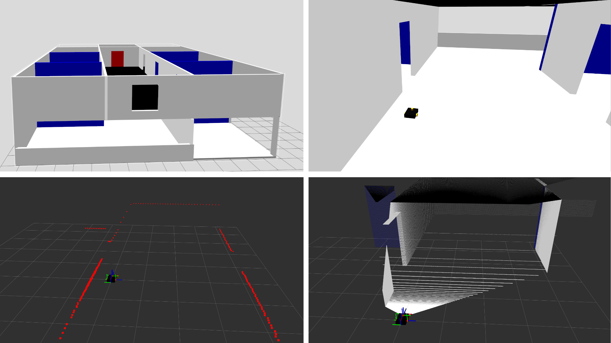

# 🦾 Multifloor Autonomous Navigation (ROS 2 Jazzy)



This repository contains the ROS 2 workspace for **teleoperation, mapping, and autonomous navigation** of the DiffBot simulation.  
It includes simulation setup, velocity mapping, SLAM configuration, and navigation modules.

---

## 📁 Project Overview

This project presents a complete **ROS 2 Jazzy-based simulation framework** for autonomous navigation using the *DiffBot* platform.  
It integrates simulation, mapping, and navigation pipelines in a modular and reproducible workspace.

**ROS 2 Distribution:** *Jazzy Jalisco*  
**Simulation Environment:** *Gazebo Sim / RViz2*  
**Primary Package:** `diffbot_learning`

The workspace is organized into three operational phases:
1. **Teleoperation** – Manual control for system validation and motion testing.  
2. **Mapping** – Environment exploration and 2D map generation using SLAM Toolbox.  
3. **Autonomous Navigation** – Path planning and goal-based navigation using the generated map.

Each phase is designed for extensibility, enabling future integration with additional sensor modules, localization methods, and multi-floor navigation strategies.

---

## 🚗 1. Teleoperation

Manually control the robot in simulation.

### Launch Commands

```bash
# Launch simulation
ros2 launch diffbot_learning sim.launch.py

# Run velocity mapper node
python3 src/scripts/vel_mapper.py

# Teleoperate using keyboard
ros2 run teleop_twist_keyboard teleop_twist_keyboard
```

---

## 🗺️ 2. Mapping

Create a 2D map of the environment using **SLAM Toolbox** while manually teleoperating the robot.

### Launch Commands

```bash
# Launch simulation
ros2 launch diffbot_learning sim.launch.py

# Run velocity mapper node
python3 src/scripts/vel_mapper.py

# Launch SLAM Toolbox in online async mode
ros2 launch slam_toolbox online_async_launch.py \
  params_file:=src/config/mapper_params_online_async.yaml \
  use_sim_time:=true

# Teleoperate to map the area
ros2 run teleop_twist_keyboard teleop_twist_keyboard
```

After exploring the environment, save your map (in another terminal):

```bash
ros2 service call /slam_toolbox/save_map slam_toolbox/srv/SaveMap "{name: 'map'}"
```

This will generate `map.pgm` and `map.yaml` files.

---

## 🤖 3. Autonomous Navigation

Use the saved map for autonomous navigation and path planning.

### Launch Commands

```bash
# Launch simulation
ros2 launch diffbot_learning sim.launch.py

# Run velocity mapper node
python3 src/scripts/vel_mapper.py

# Launch SLAM Toolbox in localization mode
ros2 launch slam_toolbox online_async_launch.py \
  params_file:=src/config/mapper_params_online_async.yaml \
  use_sim_time:=true
```

Then launch your **navigation** stack (if configured, e.g., Nav2):

```bash
ros2 launch nav2_bringup navigation_launch.py use_sim_time:=true map:=src/maps/map.yaml
```

---

## ⚙️ Folder Structure

```
ros_ws/
├── src/
│   ├── diffbot_learning/
│   ├── scripts/
│   │   └── vel_mapper.py
│   ├── config/
│   │   └── mapper_params_online_async.yaml
│   └── maps/
│       └── map.yaml / map.pgm
└── README.md
```

---

## 🧠 Notes

- Ensure `teleop_twist_keyboard` and `slam_toolbox` are installed:
  ```bash
  sudo apt install ros-jazzy-teleop-twist-keyboard ros-jazzy-slam-toolbox
  ```
- Always use `use_sim_time:=true` when running with Gazebo simulation.
- The `vel_mapper.py` node converts simulation velocity commands into a compatible format for the robot controller.

---

## 🧩 Author

**Siddharth Umakarthikeyan**  
Robotics Engineer @ Telenex Robotics  
📧 [siddharth.some@gmail.com]  
🌐 [https://github.com/siddharthumakarthikeyan](https://github.com/siddharthumakarthikeyan)
